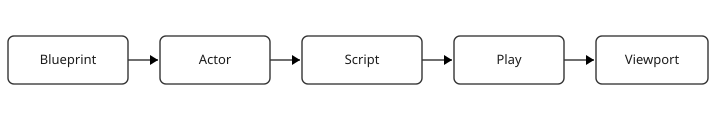
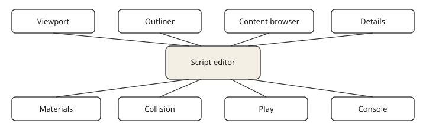

# MeshForge script editor

This guide is for someone making a level. It explains the script window, how actors and blueprints work, how a script shows up in the viewport, and how an AI can help. It does not assume you write code for a living.



## 1. What the script editor is

The script editor is a window for the small programs that make a level do something when you press Play. A door can open. A pickup can vanish. A companion can walk toward the player and answer a line of speech.

Open it in any of these ways:

- Click the **Script** tab.
- Double-click an actor in the view or in the outliner.
- In the Details panel, under **Actor**, click **Edit Script**.
- Right-click an actor or a blueprint and choose **Edit Script**.

The window can float. Drag the title bar to move it, and drag the corner to resize it. **Dock** pins it along the bottom. **Float** puts it back. Each open script is a tab.

The code area highlights keywords, strings, numbers, and comments. **Validate** checks the script and prints errors with line numbers in the console under the code. **Save** writes it into the project. MeshForge also writes the project on a short timer after you edit, using the same autosave as the rest of the level.

Ctrl+Z inside the code box undoes typing. Saving a script, or accepting an AI edit, is also one step on the level undo stack.

## 2. What can have a script

Five kinds of thing can carry a script.

| Kind | What it is | What the script usually does |
| --- | --- | --- |
| Programmable material | A material with a GLSL snippet and named parameters | Changes colour, glow, and the states on that material. This tab is the shader, not gameplay code. |
| Static mesh / Static actor | A prop, a wall, a door, a pickup | Reacts when something touches it or when an event arrives |
| Character blueprint, and a placed Character | The body the player drives in Play | Reads input, or leaves walking to the built-in Character movement |
| NPC/AI blueprint, and a placed NPC | A character that is not the player | Patrols, follows, listens, and talks |
| Level | The scene itself | Hears events from the whole level |

A **blueprint** is an asset in the content browser, under Blueprints. It remembers an actor type, a shape, a collision setup, and a script. Drag it into the view, or ask an agent to spawn it. That makes an **actor**: one placed copy. The copy starts with the blueprint's script. If you edit the copy's script, that copy keeps its own version. The blueprint's other copies stay as they were. The Details panel shows the blueprint name and whether this actor has its own script.

Every object in the scene is an actor. The type is Static, Character, NPC/AI, or Level. Change it from the Type menu in Details. The scene root is the Level actor. Its script is the level script.

Collision comes with the actor. Presets are BlockAll, OverlapAll, NoCollision, Pawn, and Water. Shapes are box, sphere, capsule, convex, and complex. Double-click a mesh in the content browser to open the collision editor. Right-click an actor and choose **Edit Collision**, or use the button in Details. Turn on **Collision** in the view header to see the shapes. A Character or NPC defaults to a Pawn capsule. A spawn point defaults to no collision.

**Play** runs the open scene. **Stop** puts transforms back and deletes anything a script spawned during Play. Escape also stops. Only a Character actor walks with the keys. WASD or the arrow keys move it. Space jumps. E calls `onInteract` on actors it is touching.

## 3. How a script meets the rest of the editor



- **Viewport.** Play shows the result. A script moves an actor by asking for a new position or rotation. The view draws that. It does not run the script itself.
- **Outliner.** Every row is an actor. Double-click it to edit the script. The eye still hides the object. H and Shift+H still work when you are not playing.
- **Content browser.** Drag a mesh onto the view or onto a landscape slot. Drag a blueprint to place an actor. Double-click a mesh for collision. Double-click a blueprint or a programmable material to edit its script or shader.
- **Details.** Actor type, spawn checkbox, collision summary, and Edit Script. If the actor uses a programmable material, the material section is still there for live parameters.
- **Materials.** A gameplay script can set a parameter or a named state. The shader tab in this same window edits the GLSL and the parameter list. Build with AI on the material window is unchanged.
- **Collision.** Overlap and hit hooks fire from these shapes during Play. BlockAll pushes a Character. OverlapAll only notifies the script. NoCollision does neither.
- **Play.** Scripts start when you press Play and stop cleanly when you press Stop. They do not run while you are editing.
- **Console.** The strip under the code shows Validate errors and `api.log` lines. The status bar at the bottom of MeshForge still shows editor messages.

A script is a set of functions. You only write the ones you need.

| Function | When it runs |
| --- | --- |
| `onStart()` | Once, when Play begins |
| `onUpdate(dt)` | Every frame. `dt` is seconds |
| `onOverlap(other)` | When another actor starts touching this one |
| `onHit(other)` | When two BlockAll shapes hit |
| `onInteract(by)` | When the player presses E while touching this actor |
| `onEvent(name, data)` | When any script emits that name |
| `onSpeak` / `onHear(who, text)` | When something is said. The agent panel also sends what it speaks |
| `api.after(seconds, fn)` | A timer |

`other` has `id`, `name`, `type`, `position`, and `hasTag`.

The whitelist on `api` is the only way out of the script:

- `transform`, `setPosition`, `setRotation`, `setScale`, `rotate`, `move`, `moveToward`
- `components`, `materialParams`, `setMaterialParam`, `setMaterialState`
- `spawn`, `destroy`, `findActors`
- `emit`, `input`, `say`, `log`, `after`

`findActors` can filter by type, name, tag, or spawn. `input` returns axes, jump, and interact while a Character is being driven.

Templates in the editor menu: Rotate, Patrol NPC, Door trigger, Pickup, Companion idle and emotions, Level script. Pick one, then change the numbers.

## 4. Make a small game

This is a yard with a hut, a cover wall, a door, a pickup, a player, and a companion. You can click it together, or run the script in the next section and then change it.

1. Start MeshForge. Press **Play** on an empty scene once so you know Stop brings you back. Press Stop.
2. Open the Landscape tab. Set the map size from an agent, or leave the default, and send the landscape into the scene. The ground is one group: terrain, water, buildings, trees.
3. Add a cube. In Details, leave the type as Static. Edit Collision and choose BlockAll, box. Scale it into a low wall. This is cover.
4. Add a building the same way, or use **Place** with kind `building`. Give it BlockAll too.
5. Add a thin cube in the doorway. Set collision to OverlapAll. Edit Script, choose the **Door trigger** template, and Save. When the Character overlaps it, the door moves up and emits `door`.
6. Add a sphere. OverlapAll. Use the **Pickup** template. Touching it emits `pickup` and removes the sphere until Stop.
7. Add a capsule. Set the type to **Character**. Collision becomes a Pawn capsule. This is the body you drive. Mark another small object as a spawn point in Details, or add a spawn. On Play, the Character is moved to the spawn.
8. Add another capsule. Set the type to **NPC/AI**. Use the **Companion** template. It walks toward the Character. If the agent says "hello" or "sad", the companion answers and asks its material for the happy or sad state. That state only changes the look if the mesh uses a programmable material that has those states. The Screen Face preset does.
9. Press Play. Walk into the pickup and the door. Press E beside the companion. Press Stop and check that the pickup is back.

To give the companion a face, assign the Screen Face programmable material, then open that material from the content browser. The script editor shows the GLSL and the parameter JSON. You can leave the shader alone and still call `api.setMaterialState('happy')` from the companion script.

The level script is the scene root. Select nothing, or select the scene, and click Edit Script. The level template logs every event, so the door and the pickup show up in the console.

## 5. How an AI helps

There are four doors an AI can use. None of them stores an API key in the project. Keys stay in the Agent session.

**Agent panel.** Connect a provider, then talk. The model can only call the fixed tool list. New tools cover scripts and level building: list and read scripts, set and validate a script, attach or detach one, create a blueprint, spawn an actor, set an actor type, list actors, start and stop Play, start a new project, set the landscape size, place a primitive, set collision, add a spawn, and save the project. Older tools still move objects, edit materials, and send the landscape into the scene. Delete and New project ask you first. Each edit is one undo step. Live material changes are not undo steps, same as before.

**Voice.** If the browser has the speech API (Chrome or Edge), the Agent panel can listen and can speak replies. Spoken replies are also delivered to scripts as `onHear` while Play is running. A companion can react without you writing a chat window.

**Ask AI in the script editor.** Type a short brief under the code and press Ask AI. MeshForge sends the current script and the brief to the connected provider. You get a line diff. Accept writes it into the tab. Reject throws it away. If the reply is not a legal script, it is refused and the tab stays as it was. With no provider connected, the box says so and you edit by hand.

**The agent API for an outside program.** The same actions are on `window.MeshForge`, so a script or another program can build a level without clicking:

`newProject`, `setLandscapeSize`, `generateLandscape`, `sendLandscapeToScene`, `placePrimitive`, `setActorType`, `setCollision`, `setScript`, `addSpawn`, `createBlueprint`, `spawnActor`, `listActors`, `runPlay`, `stopPlay`, `saveProject`.

`scripts/build_level.mjs` does a whole yard this way and only calls those methods. Run it against a live MeshForge:

```
node scripts/build_level.mjs http://127.0.0.1:8000/?noautosave=1 C:\MeshForge\demo-yard.mfproj
```

On Windows, start `run_windows.bat` first so that address is open. Copy the file and add more BlockAll cubes where you want cover. That is the shape of a shooter level: a landscape, walls, spawn points, a Character, and NPC actors with scripts. MeshForge does not yet contain a gun, a health number, or a finished AI body. The Character actor is the body Play already moves. An outside AI drives the editor through this API. It does not walk around inside the level as its own puppet yet.

`setLandscapeSize` takes width, depth, and height in metres. The map is square, so depth uses the same edge as width. The call says so in its note. Height scales the hills.

`saveProject` needs a path ending in `.mfproj` and the MeshForge server, because the file is written on that computer. The zip holds `scene.json`, `scene.glb`, `materials.json`, and `scripts.json`.

File ▸ Open reads that zip back as separate actors. It does not squash the level into one small mesh. `MeshForge.openProject(bytes or url)` does the same thing. Scripts are stored against the actor's saved id, including the level, whose id stays `level`.

`sendLandscapeToScene` keeps the landscape's real size. Pass `scale` or `size` when you want a different one. It no longer shrinks a large map to sit beside a small prop. The camera far plane starts at 2000 m and grows with the scene. `setCameraClip({ near, far })` sets it directly. `getGroundHeight(x, z)` reads the terrain. In Play, a Character stands on that height instead of falling to zero.

A spawn can carry a team: `addSpawn({ name, position, team: 'red' })`. The team is saved and shows up in `listActors`. `setScript` and `setCollision` return an error when the id does not match an actor. They do not write onto the whole level by mistake.

Overlap events skip the Level actor and any mesh named Terrain or Water, so a ground plane does not count as touching every prop. Assigned materials stay visible in solid view, not only in the toon view. Matcap and wire use the material colour too.

## 6. Safety and limits

A script is gameplay code, not a plugin. Plugins are trusted and are not sandboxed. Scripts are.

- In the browser, Play runs each script in a **Worker**. The Worker is not given the page, the editor objects, or a way to reach the network. Before the script is compiled, `fetch`, `XMLHttpRequest`, `WebSocket`, and `importScripts` on that Worker are replaced with functions that throw.
- The script is wrapped so names such as `window`, `document`, `fetch`, `Function`, `globalThis`, `process`, and the storage APIs are local undefined values. `api` is the only object passed in.
- A check runs first. It rejects `eval`, `Function`, `constructor`, `import`, `fetch`, `document`, `window`, and the other names above. The word `eval` cannot be turned off by a local variable, because strict mode forbids that binding, so the checker refuses the script instead.
- If the Worker cannot start, MeshForge uses the same wrapper on the page thread and says so in the script console. A script that never returns can freeze the tab in that fallback. The page is still not passed in.
- This is not a security product. The checker and the Worker block the obvious paths. A script written to escape a Worker might still find a new one. Do not run hostile scripts from the internet.
- Scripts cannot read API keys, files, or another site. Logs stay in the console.
- Ask AI and the agent tools never write the key into the asset or the project.

## 7. What is untested

- Not tried on Windows, on a real GPU, or with a real mouse. The logic tests and a headless Chrome smoke test were run on Linux.
- `scripts/build_level.mjs` was run against an in-memory editor that implements the same method names, and the live page was checked for place, type, script, Play (Worker), Stop, and landscape size. A full `.mfproj` was not written through `run_windows.bat`.
- Ask AI was checked with a refused network script and a diff. It was not sent to a live provider.
- The Worker was probed in a Node worker and by pressing Play in headless Chrome. Nobody tried to break out of it on purpose beyond the blocked names.
- Walking a Character across the landscape, the collision preview, and spoken `onHear` were not sat through by a person.
- A programmable material state on a companion was not watched in the view during Play.

## Appendix. Keyboard and mouse shortcuts

These are the shortcuts the program actually handles. They were taken from the key and mouse handlers. While a text box, a dropdown, or the script code area is focused, the main editor ignores letter keys so you can type. The script window keeps Ctrl+Enter and Ctrl+S.

The camera code contains arrow-key panning, but MeshForge never turns that listener on. During Play the arrows move the Character instead. They do not pan the view.

Ctrl or Cmd with Numpad 1, 3, or 7 (or the matching top-row key) snaps the opposite view: back, left, or bottom. The corner axis widget does the same when you click the far ball.

### Global

| Input | Action |
| --- | --- |
| Ctrl+Z or Cmd+Z | Undo |
| Ctrl+Shift+Z or Cmd+Shift+Z | Redo |
| Ctrl+Y or Cmd+Y | Redo |
| Click a ball on the corner axis widget | Snap the view to that side, including back, left, and bottom |
| Numpad 1, or the 1 key outside Edit Mode | Front view. Ctrl or Cmd shows the back |
| Numpad 3, or the 3 key outside Edit Mode | Right view. Ctrl or Cmd shows the left |
| Numpad 7, or the 7 key outside Edit Mode | Top view. Ctrl or Cmd shows the bottom |
| Numpad 5, or the 5 key outside Sculpt Mode | Perspective / orthographic |
| Numpad decimal, period, or Home | Frame the selection |
| Z, when you are not mid-transform | Wireframe / solid |
| Middle mouse drag | Orbit |
| Shift+middle mouse | Pan |
| Right mouse drag | Pan |
| Shift+right mouse, or Ctrl/Cmd+right mouse | Orbit |
| Mouse wheel | Zoom |
| Left mouse on the Orbit, Pan, or Zoom shelf tool | That navigation action. Shift, Ctrl, or Cmd swaps orbit and pan |
| Left mouse on Select, Move, Rotate, or Scale | Pick or drag the gizmo. The camera does not take the left button |

### Object Mode

| Input | Action |
| --- | --- |
| Left click | Select. Shift toggles |
| Left drag with the Select tool | Box select. Shift adds |
| Right click | Menu: Edit Script, Edit Collision, Group, Ungroup, Join, Select Similar |
| Double-click an object | Open its script |
| G, then move the mouse | Move. Enter or Space confirms. Escape cancels. Right click cancels. Left click confirms |
| R | Rotate, same confirm and cancel |
| S | Scale, same confirm and cancel |
| X, Y, or Z during G/R/S | Lock that axis. Press the same key again to unlock |
| Ctrl held during G/R/S | Snap. 0.1 units, 15 degrees, or 0.1 scale. Release Ctrl to stop snapping |
| G, R, or S during a gesture | Switch the gesture |
| A | Select all, or clear if everything is already selected |
| Alt+A | Clear the selection |
| Escape | Clear the selection, or cancel a gesture |
| H | Hide the selection |
| Shift+H | Show hidden objects |
| Delete | Delete the selection |
| Shift+D | Duplicate the selection |
| Tab | Edit Mode. From Sculpt or Pose, Tab returns to Object Mode |
| Drag a gizmo arrow, ring, or handle | Move, rotate, or scale when that shelf tool is on |

### Edit Mode

| Input | Action |
| --- | --- |
| 1, 2, 3 on the top row | Vertices, edges, faces. Numpad 1 and 3 still change the view |
| Left click | Select the element under the pointer. Shift toggles |
| Left drag | Box select visible elements. Shift adds |
| A, Alt+A, G, R, S, X, Y, Z, Ctrl, Enter, Space, Escape | Same as Object Mode, on the selected elements |
| Tab | Back to Object Mode |
| U, in Edit Mode or the UV workspace, when the pointer is not over the 2D view | Open the UV menu. Escape closes it |

### Sculpt Mode

| Input | Action |
| --- | --- |
| Left drag on the model | Sculpt with the current brush |
| Shift held while stroking | Smooth |
| Alt held while stroking | Invert the brush |
| 1 to 0 | Standard, Clay, Clay Buildup, Move, Smooth, Chisel, Carve, Pen, Inflate, Pinch |
| Shift+1, Shift+2, Shift+3 | Flatten, Crease, Scrape. The handler also accepts the shifted symbols !, @, ", #, and £ |
| M | Mask brush |
| Alt+M | Clear the mask |
| Ctrl+I or Cmd+I | Invert the mask |
| S, then move the mouse, then release S | Brush size |
| U, then move the mouse, then release U | Strength |
| [ or { | Smaller radius. With Shift, lower strength |
| ] or } | Larger radius. With Shift, higher strength |
| X | X symmetry on or off |
| L | Lazy mouse on or off |
| F | Cycle falloff |
| D | Adaptive detail on or off |
| H | Show or hide the sculpt shortcut list |
| Tab | Back to Object Mode |
| Ctrl+Z | Undo a stroke, through the normal undo keys |
| Pen pressure | Strength by default. Size if that checkbox is on |

### UV 2D view

These apply while the pointer is over the 2D UV view.

| Input | Action |
| --- | --- |
| Mouse wheel | Zoom |
| Middle or right drag | Pan |
| Left click | Select the island under the pointer. Shift adds |
| Left drag | Box select islands |
| G, R, S | Move, rotate, or scale the selection |
| X or Y during that gesture | Constrain to that axis |
| Enter or left click | Confirm |
| Escape or right click | Cancel |
| A | Select all islands |
| Alt+A | Clear |
| Home | Fit the islands in the view |
| B | Brush tool |

### Shader and material paint

| Input | Action |
| --- | --- |
| P | Turn material paint on or off. Only in the Shader workspace, or when paint is already on. Not in Landscape or Sculpt |
| Left drag on a mesh | Paint face material, vertex colour, or the texture, matching the paint mode |
| Left drag off the mesh | Orbit, as usual |
| Pen pressure | Used when the pressure checkbox is on |

### Landscape

Only while the Landscape workspace is open.

| Input | Action |
| --- | --- |
| Left drag with Brush or Erase | Paint the map |
| Left drag with Rect or Circle | Draw a region |
| Left click or drag with Lasso | Add points. A long drag draws freehand and closes on release |
| Double-click | Close the lasso |
| Enter | Close the lasso draft |
| Escape | Cancel the draft |

### Play

Only while Play is running, and not while typing in a text box.

| Input | Action |
| --- | --- |
| Escape | Stop Play and restore transforms |
| W, A, S, D or the arrow keys | Move the Character actor |
| Space | Jump |
| E | Interact with overlapping actors |

### Script editor

| Input | Action |
| --- | --- |
| Ctrl+Enter or Cmd+Enter | Validate the open script |
| Ctrl+S or Cmd+S | Save the open script into the project |
| Ctrl+Z inside the code box | Undo typing in that box |
| Drag the title | Move the window, unless it is docked |
| Drag the corner | Resize |
